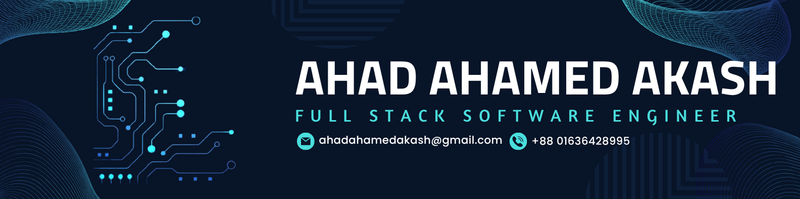

# Hi, I'm Ahad Ahamed Akash 👋

I build the full stack of a product, from the screen a customer taps to the database behind it, and I catch problems before users do.

## 🚀 What I do:
- **Ship features end to end, with the stack that fits the project.** I choose tools by what the problem needs, not by habit. My daily tools are React, Next.js, NestJS and PostgreSQL, and when a project needs something new, like Python for AI, I learn it and ship with it.
- **Make systems safe to trust.** In Turvo, my multi-tenant booking platform, each business's data is isolated at the database level, and two people can never book the same slot.
- **Keep teams moving.** At AB Software Solutions I built production interfaces, connected REST APIs, and worked directly with designers and backend developers.
- **Move fast with AI, without getting sloppy.** I use Claude Code daily, but I write the spec first and review every line it produces.

## 🌱 What I'm adding next:
Python and FastAPI, so I can build AI features into products properly.

## 🧠 How I think:
I solve problems in C++ on Codeforces (Pupil) and CodeChef (2★), so I look for edge cases and performance problems before they reach production.

## 📫 Open to work:
Full Stack Developer and Software Engineer roles, remote or international.

<!--
<h1 align="left">👋 Hi, I am Ahad Ahamed Akash</h1>

###

I'm a **Full Stack Developer** dedicated to building modern, scalable web applications primarily with **React.js**, **Next.js**, **JavaScript** **TypeScript**, and **Tailwind CSS**.

**My focus?** Delivering high-performance, clean - architecture solutions that are responsive & accessible. I've successfully built full-stack applications using the **MERN stack**, and I integrate modern UI libraries like **ShadCN UI** and **MUI** to build interactive interfaces. Need smooth interactions? I use **Framer Motion** & **GSAP** for captivating animations.

I enjoy solving complex problems and have recently been active in **Competitive Programming**, regularly practicing on LeetCode, Codeforces, and CodeChef to strengthen my problem-solving and algorithmic thinking.

###

## 🌐 Socials:

     
-->

## 💻 Tech Stack:

###

  
  
  
  
  <!-- 
   -->
  <!-- 
   -->
  
  
  
  
  
  
  <!-- 
   -->
  <!-- 
   -->
  
  
  
  
  
  
  
  
  
  
  
  
  
  
  
  
  
  
  
  
  <!-- 
   -->
  
  
  
  
  <!-- 
   -->
  
  
  <!--  -->
  <!--  -->
  <!--  -->
  <!--  -->
  
  
  <!--  -->
  
  
  
  
  
  
  
  
  
  
  
  
  
  
  
  
  
  
  
  
  
  
  
  
  
  
  
  
  

<!--

  
  
  
  
  
  
  
  
  
  
  
  
  
  
  
  
  
  
  
  
  
  
  
  
  
  
  
  
  
  
  
  
  
  
  
  
  
  
  

-->

## 📊 GitHub Stats:

  

  

## 🧩 Competitive Programming:

  

  
  
  
  

  

    

<!-- 

  

 -->

<!-- ## 🏆 GitHub Trophies
-->

###
